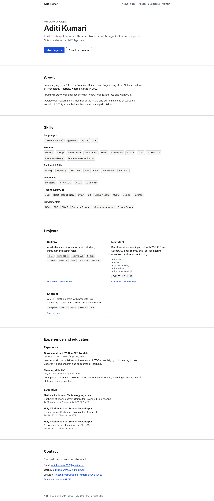

# Aditi Kumari, portfolio

Personal portfolio for Aditi Kumari, a Software Engineer, written for recruiters. It is a single dark-themed page:
hero with an "Immediate joiner" badge, two scrolling role bands, an at-a-glance row, About, Experience, Education
and achievements, Skills grouped like the resume, Projects (with filter tabs), a hiring contact form and a footer,
plus a resume download. The look follows a reference site the owner chose; all text and images are her own.
The original static HTML/CSS site is kept in `legacy/`.

## Stack

- Next.js 15 (App Router), React 19, TypeScript (strict)
- Tailwind CSS 3, react-icons
- `next/font` (Poppins), `next/image`, metadata with Open Graph tags, `robots.ts`, `sitemap.ts`, SVG favicon
- Jest, React Testing Library, jest-dom
- ESLint (`next/core-web-vitals`, `next/typescript`)
- GitHub Actions CI

The page is statically rendered. Only the project filter tabs and the contact form are client components.

## Run

Requires Node 20 (`.nvmrc`).

```bash
npm ci
npm run dev          # http://localhost:3000
npm run build
npm start
```

## Check

```bash
npm run lint
npm run typecheck
npm test
npm run test:coverage
```

Last run: 92 tests in 4 suites passed; `tsc --noEmit`, `next lint` and `next build` pass without warnings.
The tests cover the components (project card, skills list, navigation, contact links, page structure),
data integrity (required fields, https URLs, non-empty skill groups, resume file exists in `public/`,
no phone number in profile data), and a check that no data string contains "lorem" or "todo".

## Structure

```
app/              layout, page, globals.css, robots.ts, sitemap.ts, icon.svg
components/       one component per section, plus ProjectCard, ProjectGrid, ContactForm, Marquee, Icon
lib/              contact form validation and mailto builder
data/             typed content: profile, projects, skills, background, nav, types
public/           Aditi-Kumari-Resume.pdf, projects/ (resized screenshots from the project repos)
__tests__/        Jest tests
docs/             screenshots and the Lighthouse summary
legacy/           the original static site, unchanged
.github/workflows/ci.yml
```

## Add a project

Append an object to the array in `data/projects.ts`. The `Project` type is in `data/types.ts`:
`slug`, `name`, `summary`, `stack`, `categories` and `areas` are required; `codeUrl`, `liveUrl`, `image` and `features` are optional.
Put a resized screenshot in `public/projects/` and set `image`. A project with no `codeUrl` is shown without a GitHub button.
The data tests check that URLs are https and slugs are unique.

## Deploy on Vercel

Import the GitHub repository in Vercel. The framework preset is detected as Next.js and no
environment variables are needed. Then set `siteUrl` in `data/profile.ts` to the real domain, because
it is used for canonical, Open Graph and sitemap URLs (the current value is a placeholder).

## Lighthouse

Measured on 2026-11-01 after the recruiter-focused rewrite against the production build (`npm run build && npx next start -p 5500`),
Lighthouse 12.8.2, mobile emulation (default), system Chrome:

```bash
CHROME_PATH="/Applications/Google Chrome.app/Contents/MacOS/Google Chrome" \
  npx lighthouse http://localhost:5500 --chrome-flags="--headless=new --no-sandbox" \
  --only-categories=performance,accessibility,best-practices,seo --output=json
```

| Category | Score |
| --- | --- |
| Performance | 98 |
| Accessibility | 100 |
| Best practices | 100 |
| SEO | 100 |

FCP 1.1 s, LCP 2.3 s, TBT 10 ms, CLS 0, Speed Index 1.1 s. Lighthouse still lists small opportunities: render-blocking CSS, legacy and unused JavaScript from the Next.js runtime, and project screenshots that could be served smaller. These were measured on localhost, so real-world numbers on Vercel will differ. Summary: `docs/lighthouse-summary.json`.

## Screenshots

Desktop (1440 px wide, full page):



Mobile (390 px wide, full page):


A script run with playwright-core at 390 px width found no horizontal overflow
(scroll width 390, client width 390), all six nav anchors point to existing sections, and the resume
link downloads `Aditi-Kumari-Resume.pdf` (served as `application/pdf`).

## Limitations

- No photo of Aditi is used. The images in the old site were template placeholders, a photo of someone else, or an edited photo, so none were reused. Project cards use screenshots taken from the project repositories (the Academic Insight chart is drawn from synthetic data, as the card says).
- The Cloud and Data skills (Azure, Azure Data Factory, Microsoft Fabric, PySpark) come from work experience and are not backed by a public repository; the page says so.
- The location shown for the owner is Bengaluru, where she lives and works remotely. The MAQ Software entries say Noida, the office location. "Immediate joiner" status was given by the owner.
- The skill bars in About are counts of how many listed projects use an area, not self ratings.
- The contact form (name, email, company, role, message) opens the visitor's email app (mailto). There is no backend, so nothing is stored or sent by the site.
- Dark theme only; the marquee bands stop moving when the visitor prefers reduced motion.
- The resume PDF is the owner's current resume (AditiKumari_Resume_B). It contains a phone number, which the site
  itself does not show. Replace `public/Aditi-Kumari-Resume.pdf` with a version without it if you do not want it public.
- GitHub Actions has not been run on GitHub; the workflow was only linted with actionlint.
- The `legacy/` site has known bugs; it is excluded from lint, typecheck and tests.
